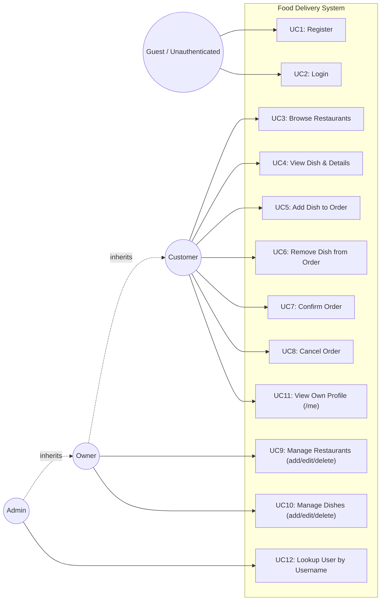
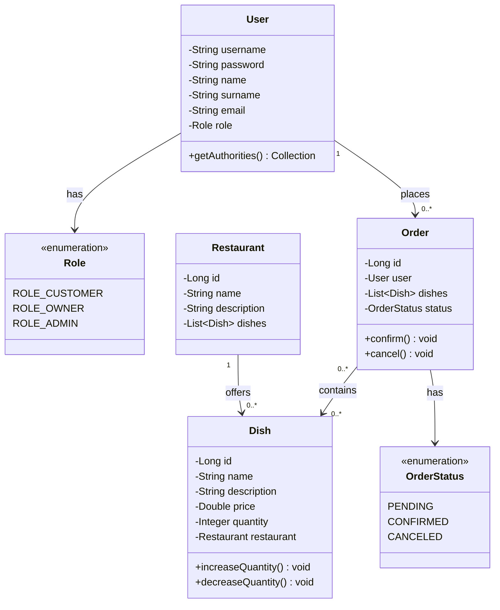
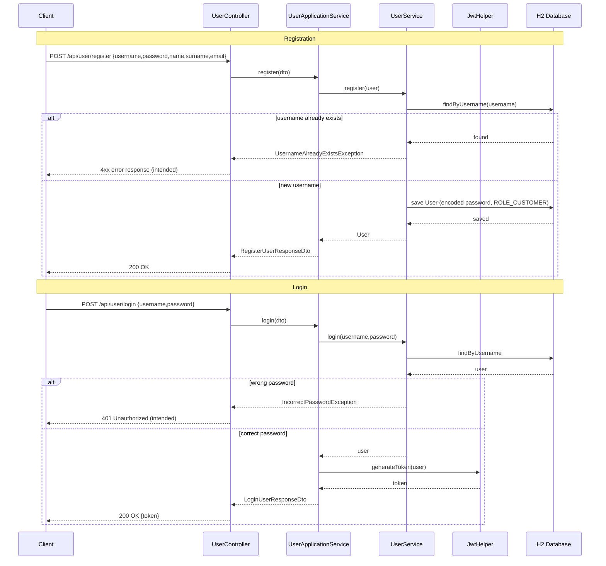
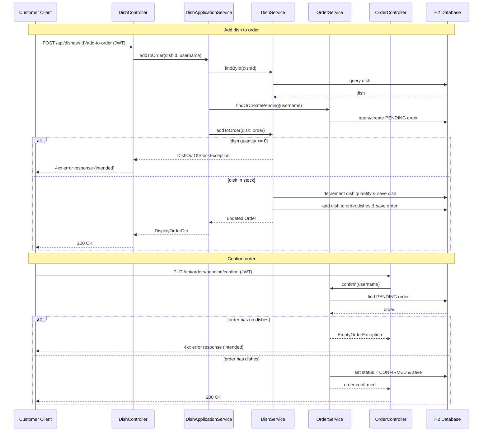
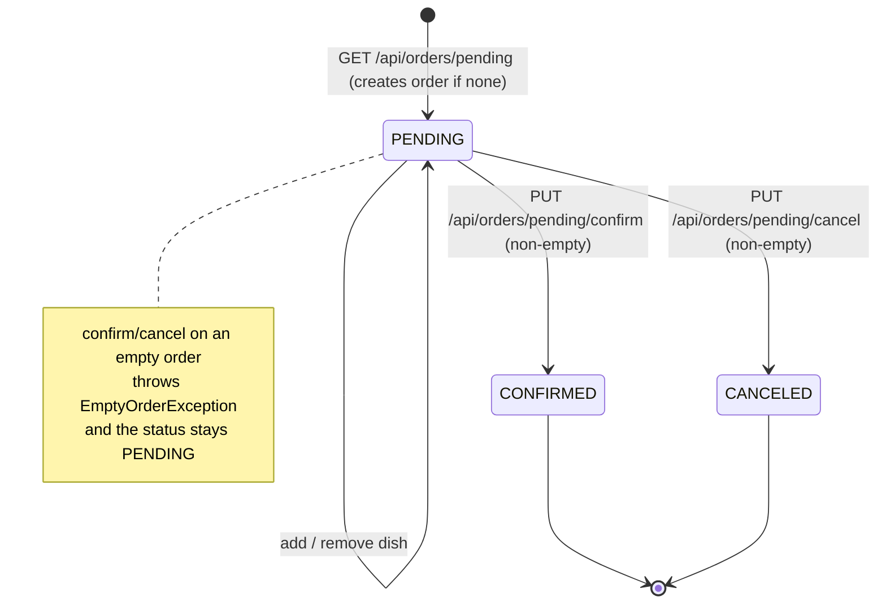

# Software Requirements Specification

## Food Delivery Web Application — `food-delivery-backend`

| | |
|---|---|
| **Prepared by** | Group 8 |
| **Application under test** | `food-delivery-backend` (Spring Boot 3.3.3, Java) |
| **Base package** | `mk.ukim.finki.fooddeliverybackend` |
| **Document version** | 1.0 |
| **Status** | Approved for review |

---

## 1. Introduction

### 1.1 Purpose

This Software Requirements Specification (SRS) describes the functional and non-functional requirements of the **Food Delivery Web Application** backend (`food-delivery-backend`). It is intended for the development team (Group 8), testers, reviewers, and any stakeholder who needs a precise, verifiable description of what the system does and the constraints under which it operates.

### 1.2 Scope

The product is a REST backend for a food delivery platform. It allows:

- **Customers** to register, log in, browse restaurants and dishes, build a pending order by adding/removing dishes, and confirm or cancel the order.
- **Restaurant owners** to create, edit, and delete restaurants and their dishes.
- **Administrators** to manage the platform (an ADMIN account inherits OWNER rights, which in turn inherit CUSTOMER rights).

The backend is implemented with **Spring Boot 3.3.3**, uses an **H2 in-memory database**, and secures endpoints with **JWT authentication** and role-based authorization. Authentication issues JWT tokens; passwords are stored encoded; the `User` entity implements Spring Security's `UserDetails`.

Out of scope: payment processing, courier/delivery tracking, mobile applications, and production-grade persistent storage (the current system uses in-memory H2).

### 1.3 Definitions, Acronyms, and Abbreviations

| Term | Definition |
|---|---|
| SRS | Software Requirements Specification |
| JWT | JSON Web Token used for stateless authentication |
| H2 | In-memory relational database used for persistence |
| ROLE_CUSTOMER | Role allowing browsing and ordering |
| ROLE_OWNER | Role allowing restaurant/dish management; implies CUSTOMER rights |
| ROLE_ADMIN | Role with full access; implies OWNER (and thus CUSTOMER) rights |
| PENDING | Order state: dishes are being collected, not yet finalized |
| CONFIRMED | Order state: customer finalized the order successfully |
| CANCELED | Order state: customer canceled the order |
| Dish quantity | Available stock count for a dish; decremented when added to an order, incremented when removed |
| PK | Primary key (`User.username`) |
| REST | Representational State Transfer API style |

### 1.4 References

- Spring Boot 3.3.3 documentation — https://spring.io/projects/spring-boot
- Spring Security (JWT, `UserDetails`) — https://spring.io/projects/spring-security
- H2 Database Engine — https://www.h2database.com
- Mermaid diagram syntax — https://mermaid.js.org
- IEEE 830-style SRS template (adapted)
- Project source: `mk.ukim.finki.fooddeliverybackend` (Group 8 repository)

### 1.5 Overview

The remainder of this document is organized as follows: Section 2 gives an overall description of the product; Section 3 lists the functional requirements (FR-01 … FR-24); Section 4 lists the non-functional requirements; Section 5 presents system models as Mermaid diagrams (use case, domain class diagram, two sequence diagrams, a state diagram, and an activity diagram).

---

## 2. Overall Description

### 2.1 Product Perspective

`food-delivery-backend` is a self-contained Spring Boot REST service. It exposes a JSON API for food delivery operations. Data is stored in an H2 in-memory database, seeded at startup with demo data (3 users, 10 restaurants, 20 dishes). Authentication is stateless via JWT; authorization is role-based. The service is designed for development, demonstration, and testing rather than production multi-tenant deployment.

### 2.2 Product Functions

- **Account management**: register (creates `ROLE_CUSTOMER` user), login (returns JWT), retrieve user by username, retrieve the currently authenticated user.
- **Restaurant catalog**: list restaurants, view a restaurant with its dishes; owners may add, edit, and delete restaurants.
- **Dish catalog**: list dishes, view a dish and its details; owners may add, edit, and delete dishes.
- **Ordering**: customers add dishes to a pending order (decrementing stock), remove dishes (incrementing stock), then confirm or cancel the pending order.
- **Stock enforcement**: a dish with `quantity <= 0` cannot be added to an order.
- **Demo data seeding**: the database is pre-populated with 3 users (username/password pairs `customer/customer`, `owner/owner`, `admin/admin`), 10 restaurants, and 20 dishes.

### 2.3 User Classes and Characteristics

| User class | Role | Privileges |
|---|---|---|
| Customer | `ROLE_CUSTOMER` | Register, login, browse restaurants and dishes, manage a pending order, confirm/cancel the order |
| Restaurant owner | `ROLE_OWNER` | All CUSTOMER rights, plus add/edit/delete restaurants and dishes |
| Administrator | `ROLE_ADMIN` | All OWNER rights (full platform management) |

Role hierarchy: **ADMIN implies OWNER, OWNER implies CUSTOMER**. Public (unauthenticated) endpoints are limited to registration and login.

### 2.4 Constraints

- Runtime: Spring Boot 3.3.3 on the JVM.
- Persistence: H2 **in-memory** database — all data is lost on restart and re-seeded.
- Security: JWT tokens; passwords stored encoded; endpoints guarded by role checks.
- API style: REST under `/api/*` with JSON payloads.
- `User.username` is the primary key; usernames must be unique.

### 2.5 Assumptions and Dependencies

- API clients (curl, Postman, or automated tests) interact with the REST endpoints.
- Clients store and present the JWT returned by login on subsequent requests.
- Demo credentials equal the username (e.g., `customer`/`customer`).
- Network availability on the local machine; single-instance deployment.

---

## 3. Functional Requirements

Priority scale: **High** = core system behavior; **Medium** = important supporting behavior.

### FR-01 — User Registration
- **Description**: `POST /api/user/register` (public) creates a new user with role `ROLE_CUSTOMER` and an encoded password. Fields: username (PK), password, name, surname, email.
- **Priority**: High

### FR-02 — Duplicate Username Rejection
- **Description**: Registration with an existing username must fail with `UsernameAlreadyExistsException`; no user is created.
- **Priority**: High

### FR-03 — User Login (JWT Issuance)
- **Description**: `POST /api/user/login` (public) validates credentials and returns a JWT for authenticated requests.
- **Priority**: High

### FR-04 — Incorrect Password Handling
- **Description**: Login with a wrong password must fail with `IncorrectPasswordException`; no token is issued.
- **Priority**: High

### FR-05 — Retrieve User by Username
- **Description**: `GET /api/user/{username}` (`ROLE_ADMIN` required) returns the user record (`RegisterUserResponseDto`) for the given username, or HTTP 404 if not found.
- **Priority**: Medium

### FR-06 — Retrieve Current User
- **Description**: `GET /api/user/me` (any authenticated user) returns the profile of the user associated with the presented JWT.
- **Priority**: Medium

### FR-07 — List Restaurants
- **Description**: `GET /api/restaurants` (`ROLE_CUSTOMER` or higher) returns all restaurants.
- **Priority**: High

### FR-08 — View Restaurant
- **Description**: `GET /api/restaurants/{id}` (`ROLE_CUSTOMER` or higher) returns the restaurant summary (`id`, `name`, `description`) for the given id, or HTTP 404 if not found.
- **Priority**: High

### FR-09 — Add Restaurant
- **Description**: `POST /api/restaurants/add` (ROLE_OWNER or higher) creates a restaurant with a name and description.
- **Priority**: High

### FR-10 — Edit Restaurant
- **Description**: `PUT /api/restaurants/{id}/edit` (ROLE_OWNER or higher) updates an existing restaurant.
- **Priority**: Medium

### FR-11 — Delete Restaurant
- **Description**: `DELETE /api/restaurants/{id}/delete` (ROLE_OWNER or higher) removes a restaurant.
- **Priority**: Medium

### FR-12 — List Dishes
- **Description**: `GET /api/dishes` (`ROLE_CUSTOMER` or higher) returns all dishes (`id`, `name`, `description`, `price`, `quantity`, `restaurantId`).
- **Priority**: High

### FR-13 — View Dish
- **Description**: `GET /api/dishes/{id}` (`ROLE_CUSTOMER` or higher) returns a dish by id, or HTTP 404 if not found.
- **Priority**: High

### FR-14 — View Dish Details
- **Description**: `GET /api/dishes/{id}/details` (ROLE_CUSTOMER or higher) returns full dish details including its restaurant.
- **Priority**: Medium

### FR-15 — Add Dish
- **Description**: `POST /api/dishes/add` (ROLE_OWNER or higher, enforced with a role check) creates a dish with name, description, price (Double), quantity (Integer), and its restaurant.
- **Priority**: High

### FR-16 — Edit Dish
- **Description**: `PUT /api/dishes/{id}/edit` (ROLE_OWNER or higher) updates an existing dish.
- **Priority**: Medium

### FR-17 — Delete Dish
- **Description**: `DELETE /api/dishes/{id}/delete` (ROLE_OWNER or higher) removes a dish.
- **Priority**: Medium

### FR-18 — Get or Create Pending Order
- **Description**: `GET /api/orders/pending` (ROLE_CUSTOMER or higher) returns the user's existing PENDING order, or creates a new empty PENDING order if none exists.
- **Priority**: High

### FR-19 — Add Dish to Order
- **Description**: `POST /api/dishes/{id}/add-to-order` (ROLE_CUSTOMER or higher) adds the dish to the user's pending order and decrements the dish's quantity.
- **Priority**: High

### FR-20 — Out-of-Stock Rejection
- **Description**: If the dish quantity is `<= 0`, adding it to an order must fail with `DishOutOfStockException`; the order is not modified.
- **Priority**: High

### FR-21 — Remove Dish from Order
- **Description**: `POST /api/dishes/{id}/remove-from-order` (ROLE_CUSTOMER or higher) removes the dish from the pending order and increments the dish's quantity (restoring stock).
- **Priority**: High

### FR-22 — Confirm Order
- **Description**: `PUT /api/orders/pending/confirm` (ROLE_CUSTOMER or higher) sets the pending order's status to `CONFIRMED`. If the order contains no dishes, it fails with `EmptyOrderException`.
- **Priority**: High

### FR-23 — Cancel Order
- **Description**: `PUT /api/orders/pending/cancel` (ROLE_CUSTOMER or higher) sets the pending order's status to `CANCELED`. If the order contains no dishes, it fails with `EmptyOrderException`.
- **Priority**: High

### FR-24 — Demo Data Seeding
- **Description**: On startup the database is seeded with 3 users (`customer`, `owner`, `admin` — each with password equal to its username), 10 restaurants, and 20 dishes.
- **Priority**: Medium

---

## 4. Non-Functional Requirements

### 4.1 Performance
- **NFR-01 — Response time**: Typical API responses (list restaurants, list dishes, add dish to order) should return within ~500 ms under normal load in the development/test environment.
- **NFR-02 — Throughput**: The backend must serve concurrent requests from multiple customers and owners without data corruption, relying on the transactional H2 database.

### 4.2 Security
- **NFR-03 — Authentication**: All protected endpoints require a valid JWT. Passwords are stored encoded (never in plaintext) and are verified against the stored encoded value.
- **NFR-04 — Authorization**: The role hierarchy is enforced — `ADMIN` implies `OWNER` implies `CUSTOMER`. Endpoints are guarded by role (`hasRole`) so only permitted roles can create/edit/delete restaurants and dishes or manage orders.
- **NFR-05 — Input validation**: Duplicate usernames and incorrect passwords are rejected with specific exceptions (`UsernameAlreadyExistsException`, `IncorrectPasswordException`) and appropriate HTTP error responses.

### 4.3 Reliability & Data Integrity
- **NFR-06 — Consistent stock handling**: Adding a dish to an order atomically decrements its quantity; removing it increments the quantity. Stock can never go below zero — attempts throw `DishOutOfStockException`.
- **NFR-07 — Order integrity**: Confirming or canceling an empty order is rejected (`EmptyOrderException`), so a finalized order always contains at least one dish.

### 4.4 API Usability
- **NFR-08 — Clear API contract**: REST endpoints follow a consistent `/api/{resource}/...` naming scheme and return meaningful error bodies so front-end clients can handle failures.
- **NFR-09 — Demo data**: Seeded sample data (3 users, 10 restaurants, 20 dishes) is available immediately after startup to support manual testing and demos.

### 4.5 Maintainability & Portability
- **NFR-10 — Layered architecture**: Code is organized into controller/service/repository layers within `mk.ukim.finki.fooddeliverybackend`, making features independently testable and maintainable.
- **NFR-11 — Embedded database**: Uses in-memory H2, so the application runs with no external database setup; state resets on restart (suitable for dev/test, not production persistence).

### 4.6 Compatibility & Deployment Constraints
- **NFR-12 — Runtime**: Requires a Java version compatible with Spring Boot 3.3.3 and runs as a standard Spring Boot application.
- **NFR-13 — CORS**: Cross-origin request configuration is defined in the security filter chain; allowed origins are restricted to configured values.

---

## 5. System Models

### 5.1 Use Case Diagram

> Role inheritance: `ADMIN` implies `OWNER` implies `CUSTOMER`, so an Owner inherits all Customer use cases (`UC1`–`UC8`, `UC11`), and an Admin inherits all Owner use cases plus admin user lookup (`UC12`).

### 5.2 Domain Class Diagram

### 5.3 Sequence Diagram — User Registration & Login

> Note: The diagram below specifies the **intended HTTP error contract** (4xx). Deviations in the current implementation (e.g., unhandled domain exceptions returning HTTP 500 or `UsernameNotFoundException` returning 403) are documented in [DefectList.md](./DefectList.md).

### 5.4 Sequence Diagram — Add Dish to Order & Confirm Order

### 5.5 State Diagram — Order Lifecycle

### 5.6 Activity Diagram — Ordering Flow

---

*Document prepared by Group 8 for the `food-delivery-backend` application under test.*
